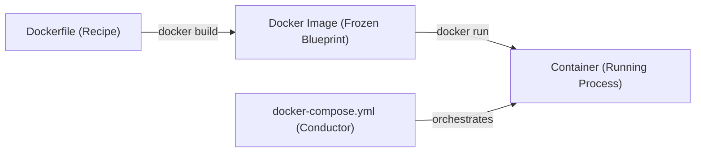
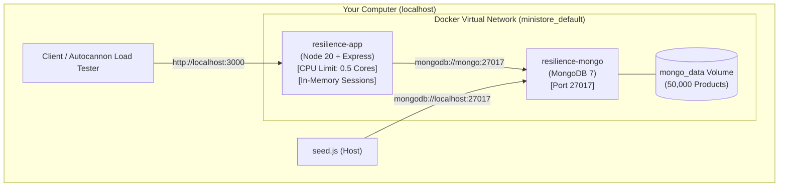

# Phase 1 Walkthrough: Beginner's Guide to the Resilience Lab

Welcome to the **Resilience Lab**! If you are new to Docker, distributed systems, and "vibe coding" with AI, this guide explains everything we built, why we built it that way, the bugs we solved, and what the benchmark numbers mean.

---

## 1. The Big Picture: What Are We Doing?

Most software tutorials show you the "happy path"—how to make things work when nothing goes wrong. In real production engineering, **systems fail constantly**: servers crash, databases get overwhelmed, networks drop packets, and memory leaks.

This project is a **hands-on laboratory**:
1. We build a small e-commerce backend ("Mini Store").
2. We **deliberately break it** or introduce bottlenecks.
3. We **measure** the damage using load-testing tools.
4. We **fix it** using industry system-design patterns (caching, load balancing, replica sets, circuit breakers).
5. We **re-measure** to prove the architectural improvement with real numbers.

---

## 2. Docker & Containers Explained Simply

If you're brand new to Docker, here are simple mental models to understand what's happening:

### The Problem Docker Solves
*"It works on my machine, but not on yours."* Different computers have different operating systems, Node versions, and background libraries. Docker packages the code **and** the entire environment together.

### Core Concepts



1. **Image (`Dockerfile`)**: A frozen snapshot containing an operating system (Alpine Linux), Node.js runtime, code, and installed dependencies (`node_modules`).
2. **Container**: A running instance of an image. You can think of an image as a cookie cutter, and containers as cookies.
3. **Docker Compose (`docker-compose.yml`)**: A conductor for orchestrating multi-container systems. In our project, it launches both our Node.js app and the MongoDB database with one command: `docker compose up`.
4. **Volumes (`mongo_data`)**: Containers are ephemeral (if deleted, their files disappear). A volume acts like an external hard drive that persists MongoDB data on your host machine even if the container stops.
5. **CPU Limits (`cpus: "0.5"`)**: In Docker Compose, we explicitly told Docker: *only give this container half of one CPU core*. Why? So that on your laptop, 20 concurrent simulated users will easily max out the CPU, allowing us to clearly observe latency bottlenecks.

---

## 3. What We Built in Phase 1 (Baseline)

In Phase 1, our goal was to establish a **working, single-instance baseline** with intentional bottlenecks.

### Architecture Diagram



### The File Structure Breakdown

| File | What It Does | Why It Matters |
|---|---|---|
| `docker-compose.yml` | Defines the `app` and `mongo` services, healthchecks, and resource limits (`0.5` CPU). | Allows anyone to run the full environment with a single command. |
| `app/Dockerfile` | Builds our lightweight `node:20-alpine` image and runs `npm ci`. | Ensures the exact same dependency tree runs inside Docker. |
| `app/server.js` | Express app entry point. Sets up routes, middlewares, error handlers, and session cookies. | Handles the HTTP requests. |
| `app/db.js` | Connects Mongoose to MongoDB with retry logging. | Database connection manager. |
| `app/middleware/instanceId.js` | Injects header `X-Instance-Id` (the container's hostname) on every response. | In Phase 2, this will let us see which of the 3 load-balanced containers handled our request. |
| `app/models/Product.js` | Product data schema. **Deliberately has NO index** on `name` or `description`. | Forces MongoDB to scan all 50,000 records on every search query. |
| `app/models/Order.js` | Order schema that stores a **price snapshot** of cart items at checkout. | Ensures if a product price changes later, past receipts remain accurate. |
| `app/routes/products.js` | `GET /products` with search & pagination. Sanitizes regex with `escapeRegex()`. | The target of our load tests. |
| `app/routes/auth.js` | Simple username login saving session in memory. | Will demonstrate cross-server session loss in Phase 2. |
| `app/routes/cart.js` & `checkout.js` | Manages shopping cart and converts it to a permanent MongoDB Order. | Core e-commerce flow. |
| `scripts/seed.js` | Generates 50,000 realistic products with 3-sentence descriptions. | Populates enough data so searches actually have to do heavy work. |
| `scripts/load-test.js` | Uses `autocannon` to hit the server with 20 concurrent connections for 20 seconds. | Records scientific before-and-after measurements. |
| `docs/experiments.md` | Standard lab notebook tracking our hypothesis, what we broke, and measured metrics. | Portfolio documentation. |

---

## 4. The "ENOTFOUND mongo" Bug We Hit (And Learned From)

When running `npm run seed` on your Windows terminal, you encountered this error:
```
MongooseServerSelectionError: getaddrinfo ENOTFOUND mongo
```

### Why Did This Happen?
- **Inside Docker**: Docker creates its own private virtual network (`ministore_default`). Inside that network, Docker has an internal DNS server. Containers can find each other by name—`app` talks to `mongo:27017`.
- **On Your Windows Host**: Your Windows machine doesn't know what "mongo" means! Your Windows machine only knows `localhost:27017` (which Docker exposed to your host).
- Because `.env` originally had `MONGO_URI=mongodb://mongo:27017/resilience_lab`, your host terminal tried to resolve the hostname `mongo` and failed.

### How We Fixed It:
1. We made [scripts/seed.js](file:///D:/projects/Mini%20Store/scripts/seed.js) smart: it tries to connect, and if it detects that host DNS cannot resolve `mongo`, it automatically falls back to `localhost:27017`.
2. We updated [.env](file:///D:/projects/Mini%20Store/.env) to point to `localhost:27017` for host tools, while `docker-compose.yml` passes `mongo:27017` to the container.

---

## 5. The Seeding Process (50,000 Products)

To test database search performance realistically, 10 or 100 products won't do—a CPU scans 100 items in less than a millisecond.

In `scripts/seed.js`:
- We generated **50,000 products**, each with a realistic multi-sentence description (e.g., noise-cancellation specs, battery life, IP68 water resistance).
- **Idempotency**: Every time the script runs, it drops the existing collection first. You can run it once or ten times, and you'll always end up with exactly 50,000 products.
- **Batching**: Inserting 50,000 records one by one takes minutes. By inserting in batches of **2,500** (`insertMany`), it finished in just **4.61 seconds**!

---

## 6. What the Benchmark Numbers Mean

We used a tool called **Autocannon** (`scripts/load-test.js`) to simulate traffic. Here are the parameters:
- **Concurrency: 20**: Exactly 20 virtual users sending requests simultaneously without waiting.
- **Duration: 20 seconds**: Traffic kept running continuously for 20 seconds.
- **Warm-up: 5 seconds**: Sent initial traffic to warm up the Node.js V8 Just-In-Time (JIT) compiler and database connection pools.

### The Recorded Baseline Results:

| Metric | `GET /products?limit=20` (List) | `GET /products?search=wireless` (Search) | What it Means |
|---|---|---|---|
| **Throughput** | **86.35 req/sec** | **129.45 req/sec** | Total completed requests per second. |
| **p50 Latency** | **199 ms** | **121 ms** | **Median**: 50% of requests were faster than this. |
| **p90 Latency** | **388 ms** | **262 ms** | 90% of requests were faster than this. |
| **p99 Latency** | **593 ms** | **380 ms** | **Tail latency**: The slowest 1% of users experienced this delay. |
| **Max Latency** | **1,617 ms** | **950 ms** | The absolute worst response time recorded (1.6 seconds!). |
| **Error Rate** | **0.0%** | **0.0%** | All requests succeeded with HTTP 200. |

### Key Takeaways:
1. **CPU Saturation**: Because the container has only `0.5` CPU cores, 20 users pushed CPU usage to its ceiling. Notice that tail latencies spiked up to **1.6 seconds**.
2. **Payload Size vs. Query**: Retrieving and serializing 20 detailed product descriptions in JSON takes CPU memory bandwidth.
3. **The Missing Index**: Right now, MongoDB has no index on product names or descriptions.

---

## 7. What's Coming in Phase 2?

Now that we have our baseline recorded in `results/data/` and tagged `v1-baseline`, here is what we will do in **Phase 2 (Scalability)**:

1. **Add MongoDB Indexing**: Create text/compound indexes and re-test to see the latency drop.
2. **Add Nginx Load Balancer**: Put Nginx in front and spin up **3 app containers** (`app1`, `app2`, `app3`).
3. **Demonstrate the Session Bug**: When you log in on `app1`, and your next request hits `app2`, your cart and login disappear because sessions are in container memory!
4. **Fix with Redis**: Introduce a shared Redis container for sessions and cart storage so the app instances become truly stateless.
5. **Cache-Aside Pattern**: Cache frequent product queries in Redis with a TTL (time-to-live) so requests don't even need to touch MongoDB.
6. **Compare Before vs. After**: Prove how much higher throughput and lower latency we get compared to Phase 1!
